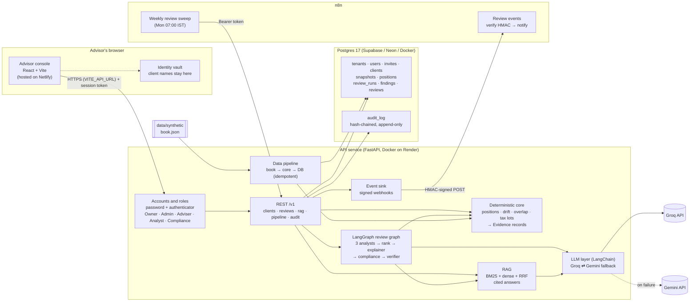
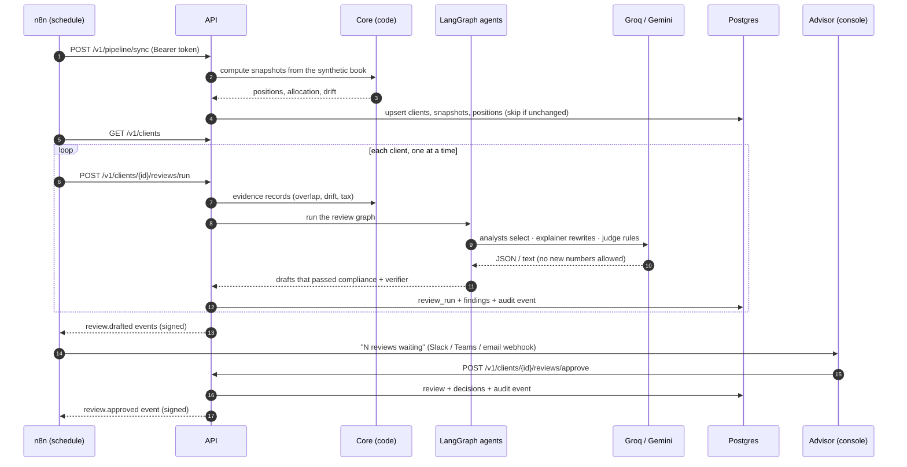
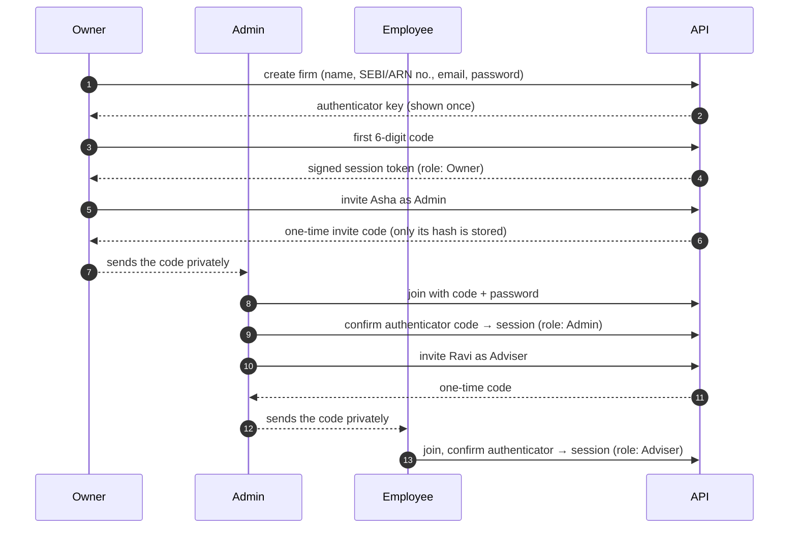
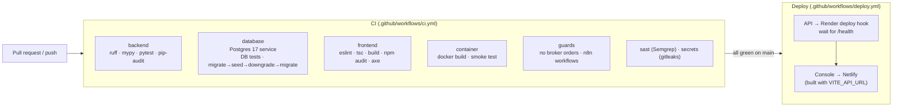
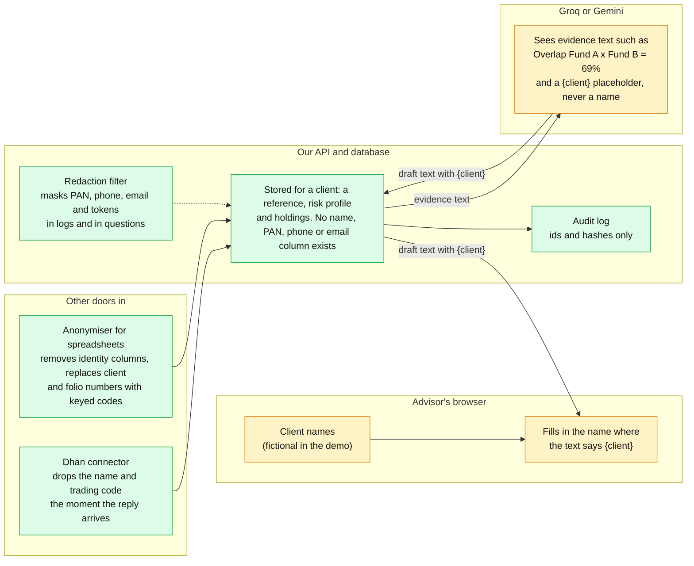
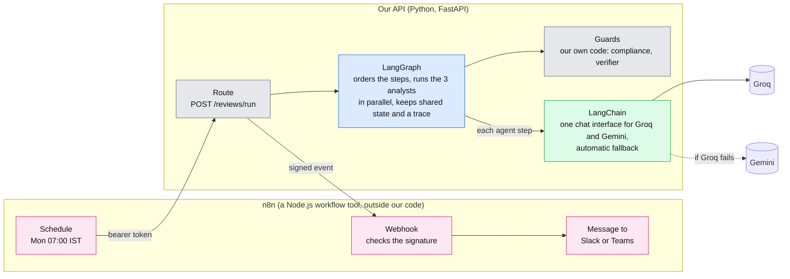
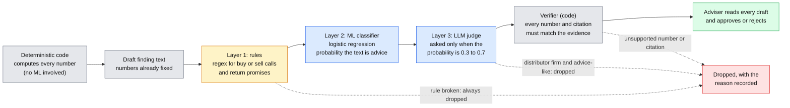
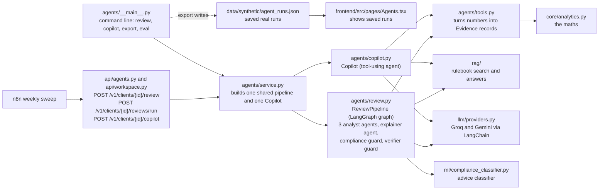
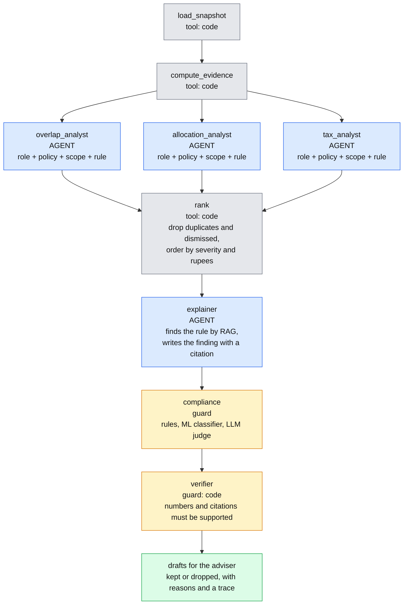

# How AI CFO works

This document explains the system as built: what runs where, how data moves, where the LLMs, LangChain, LangGraph and n8n fit, and how code gets from a branch to production. Everything below runs on **synthetic data** (`data/synthetic/`). No real person's data is used anywhere.

> One rule shapes the whole design: **code computes every number; AI only selects and explains; a human approves.**

---

## 1. System diagram



| Component | Where it runs | What it owns |
|---|---|---|
| **Advisor console** | Netlify (static files) | Screens, the in-browser demo engine, client names (never sent to the server) |
| **API** | Docker container (Render for the demo; India-region VM for real data) | Validation, routing, orchestration |
| **Deterministic core** `aicfo.core` | Inside the API | **Every number**: positions, allocation, drift, look-through exposure, overlap, tax lots |
| **Review graph** `aicfo.agents.review` | Inside the API | The multi-agent review, built with **LangGraph** |
| **LLM layer** `aicfo.llm` | Inside the API | Talking to Groq and Gemini, built with **LangChain** |
| **Data pipeline** `aicfo.db.pipeline` | Inside the API, CLI, or triggered by n8n | Loading data into Postgres |
| **Postgres** | Supabase / Neon (hosted) or Docker (local) | Persistent state and the audit chain |
| **n8n** | Docker (local) or n8n Cloud / self-hosted | Schedules and notifications |

---

## 2. The workflow, end to end



### Step by step
1. **Ingest (data pipeline).** `sync_book` reads `data/synthetic/book.json`, runs the core maths for each client and writes `clients`, `snapshots` and `positions`. A snapshot is keyed by a SHA-256 hash of its inputs, so running the sync again writes nothing until holdings, prices or the engine version change.
2. **Review (agents).** For each client the LangGraph graph runs:
   - `load_snapshot` and `compute_evidence` (code) build **Evidence** records: each holds the formula, the inputs, the steps and the result.
   - Three **analyst agents** run in parallel (overlap, allocation, tax). They choose which evidence matters and how severe it is. The LLM returns JSON that is checked against known evidence IDs.
   - `rank` (code) orders findings by severity and rupee impact.
   - The **explainer** retrieves the governing rule through RAG and cites it `[1]`. The LLM may rewrite the text in plain language.
   - **Compliance** applies rules, then the ML advice classifier, then an LLM judge for borderline scores.
   - The **verifier** (code) rejects any text containing a number that isn't in the evidence or the cited passage. A rejected LLM rewrite falls back to the template built from evidence.
3. **Persist.** The run, its trace, every finding (kept or dropped, with compliance and verifier results) and an audit event are stored.
4. **Notify (n8n).** The API posts a signed `review.drafted` event. The weekly sweep sends one summary ("4 of 12 reviews waiting").
5. **Approve (human).** The advisor accepts, dismisses or snoozes each finding, then approves. The console sends the decisions to `/reviews/approve`, the API stores them, extends the audit chain and emits `review.approved`.
6. **Verify.** `GET /v1/audit/verify` recomputes the hash chain. Any edited, deleted or reordered entry breaks it.

---

## Firm accounts and roles

**Idea:** a firm's access is controlled by the firm, not by us. The Owner creates the firm account; from then on only Owners and Admins can let anyone else in, and they choose each person's role. Nobody can sign up into an existing firm on their own.



| Role | Can do | Cannot do |
|---|---|---|
| **Owner** | Everything: team, firm settings and AI kill switch, audit, approve reviews, appoint Owners and Admins | Change their own role; leave the firm without an Owner |
| **Admin** | Invite people, change staff roles, suspend and restore, read the audit trail | See client data, approve advice, touch Owners or other Admins, grant Owner or Admin |
| **Adviser** | See assigned clients, accept findings and approve reviews, request client consent, upload data | Manage the team |
| **Analyst** | See all clients (read), upload data and resolve exceptions | Approve reviews |
| **Compliance** | See all clients (read), read the audit trail | Approve, manage the team |

**Rules, all in one place** (`backend/src/aicfo/auth/roles.py`, mirrored for the UI in `frontend/src/lib/roles.ts`):
1. You cannot change your own role or suspend yourself.
2. Only an Owner can change an Owner or an Admin, and only an Owner can grant those roles.
3. The firm always keeps at least one active Owner.
4. A role change or suspension takes effect on the very next request, because the API re-reads the user from the database instead of trusting the token.

**How it is protected**
- Passwords are hashed with scrypt (never stored). Authenticator secrets are encrypted with the firm's own data key (envelope encryption), so a database copy alone cannot generate anyone's codes.
- Invite codes are random and stored only as a hash. They expire after 72 hours and work once.
- Sign-in failures give the same message for an unknown email and a wrong password.
- Every account action is written to the hash-chained audit log by user id, never by email or name.
- One firm can never read another's rows: every lookup is scoped by firm, and other firms' records answer "not found".

## 3. Where each technology is used, and why

### LangGraph: orchestration of the agents
The review is a **state graph**, not a free-running agent. Fan-out to three analysts, fan-in to ranking, then a fixed sequence of guards. Every node records a trace event (duration, decision, detail), stored in `review_runs.trace` and replayed in the console's Agents page.

### LangChain: the LLM provider layer only
LangChain is used in one module, `aicfo/llm/providers.py`, for the two things it does better than hand-written code:
- **One chat interface over two vendors**: `ChatGroq` and `ChatGoogleGenerativeAI`.
- **Fallback across vendors**: `primary.with_fallbacks([secondary])`. When Groq's free tier returns 429 or times out, the same prompt goes to Gemini, and the reverse when Gemini is primary.

It is **deliberately not used** for chains, agents, memory or output parsers. The graph is LangGraph; the JSON checks and the number verifier are our own tested code; and agents only see the small `LLMProvider` protocol, so tests use `FakeLLM` and never touch the network.

```
agents / RAG ──▶ LLMProvider protocol ──▶ LangChainLLM ──▶ ChatGroq ──(fails)──▶ ChatGoogleGenerativeAI
                                      └─▶ OpenAICompatibleLLM (Ollama, local)
                                      └─▶ None → deterministic firm policy (CI, offline)
```

### n8n: scheduling and notifications
Two workflows in `infra/n8n/workflows/`:

| Workflow | Trigger | Steps |
|---|---|---|
| **Weekly review sweep** | Cron `0 7 * * 1` (Mon 07:00 IST) or "Run now" | sync pipeline → list clients → run each review (one at a time, 3 s apart, to respect free LLM rate limits) → summarise counts → notify if drafts are waiting |
| **Review events** | Webhook `POST /webhook/aicfo-events` | verify the `X-AICFO-Signature` HMAC → fetch pending reviews → compose message → notify |

Why n8n, not code: schedules, retries and notification channels (Slack, Teams, email, WhatsApp Business) change per firm and are edited by operations staff, not developers. The business logic stays in the API, and n8n only calls it.

**Safety:** n8n sends a bearer token (`AICFO_AUTOMATION_TOKEN`); the API signs every event with HMAC-SHA256; payloads contain IDs and counts only, never names, amounts or finding text. `scripts/check_n8n_workflows.py` fails CI if a workflow hard-codes a host, embeds credentials, skips the token, or calls an API route that doesn't exist.

### Postgres: the database integration pipeline
- **Models:** `aicfo/db/models.py`, a subset of plan §3.4. Every tenant table has `tenant_id`, ready for row-level security.
- **Migrations:** Alembic, in `aicfo/db/migrations/`. They run automatically when the container starts (`docker-entrypoint.sh`) and through `make db-migrate`.
- **Pipeline:** `aicfo/db/pipeline.py`, idempotent ingestion from the synthetic book.
- **Review store:** `aicfo/db/reviews.py`, covering runs, findings, decisions, approvals and the pending list.
- **Audit:** `aicfo/db/audit.py`, a hash-chained log with `verify()`.
- **Privacy:** no names, PAN, emails or phone numbers are stored. A test dumps every table and checks that no client name appears.
- **Tested twice:** on in-memory SQLite in every test run, and on real Postgres 17 + pgvector in CI's `database` job, which also checks that migrations exactly match the models.

---

## 4. CI/CD pipeline



- **CI** runs on every pull request and every push to `main`. It never calls a real LLM or broker API: tests use `FakeLLM`, LangChain's fake chat models, and `respx` for HTTP.
- **CD** runs only after CI succeeds on `main` (`workflow_run`), or by hand. The API deploys first; the console deploys after the API reports healthy, so the frontend never points at an API that is down.

---

## 5. Deployment

| Piece | Service | Config | What you set |
|---|---|---|---|
| Console | **Netlify** | `netlify.toml` | GitHub secrets `NETLIFY_AUTH_TOKEN`, `NETLIFY_SITE_ID`; repo variable `VITE_API_URL` |
| API | **Render** (Docker, Singapore, synthetic demo only) | `render.yaml`, `backend/Dockerfile` | `AICFO_DATABASE_URL`, `AICFO_CORS_ORIGINS`, LLM keys; GitHub secret `RENDER_DEPLOY_HOOK_URL` |
| Database | **Supabase** (Mumbai) or **Neon** | migrations run on API start | the connection string, as `AICFO_DATABASE_URL` |
| n8n | n8n Cloud, or self-hosted Docker | `infra/n8n/workflows/*.json` | `AICFO_API_URL`, `AICFO_AUTOMATION_TOKEN`, `AICFO_N8N_WEBHOOK_SECRET`, `AICFO_NOTIFY_URL` |

**Why Netlify hosts only the console:** Netlify serves static files and JavaScript/Go functions. The API is Python (FastAPI, LangGraph, numpy), so it runs as a container. With `VITE_API_URL` unset, the Netlify site is a complete offline demo that uses the in-browser engine.

**Real client data** must not go on Render Singapore or on the free LLM tiers (plan §1.4, §2). That needs India-region compute, Supabase Mumbai, and Vertex AI Gemini in `asia-south1` or the firm's own model key.

---

## 6. Guarantees, and how each is enforced

| Guarantee | Enforced by |
|---|---|
| No number comes from an LLM | Verifier rejects unsupported numbers; tests inject a fake LLM that adds numbers |
| Advice-like text is blocked for distributors (MFD) | Rules → ML classifier → LLM judge; tests per profile |
| Broker access is read-only | `scripts/check_no_order_apis.py` in CI |
| No personal data in the database or in events | Schema has no identity columns; table-dump test; payload tests |
| Audit history can't be silently edited | Hash chain + `verify()`; tamper test |
| CI never calls paid or real APIs | `tests/conftest.py` forces `AICFO_LLM_PROVIDER=none`; fakes and `respx` |
| Automation can't be spoofed | Bearer token in; HMAC-signed events out |

---

## 7. Reading the code

Every function has a short explanation above it, and nearly every statement has a one-line comment. A good order to read in:

| Step | File | What you learn |
|---|---|---|
| 1 | `backend/src/aicfo/core/analytics.py` | How every number is computed (positions, drift, overlap, tax lots) |
| 2 | `backend/src/aicfo/agents/tools.py` | How numbers become Evidence records with formulas |
| 3 | `backend/src/aicfo/agents/review.py` | The LangGraph agents: analysts, ranking, explainer, compliance, verifier |
| 4 | `backend/src/aicfo/rag/` (`retriever.py`, `answer.py`) | Hybrid search, cited answers, and the checks that reject invented numbers |
| 5 | `backend/src/aicfo/llm/providers.py` | Groq and Gemini through LangChain, with fallback |
| 6 | `backend/src/aicfo/auth/` | Roles, passwords, tokens, authenticator codes, invites |
| 7 | `backend/src/aicfo/db/` | Tables, migrations, the data pipeline, the audit chain |
| 8 | `backend/src/aicfo/api/` | The HTTP routes that tie it together |
| 9 | `frontend/src/lib/roles.ts`, `frontend/src/components/auth/` | The same role rules in the console, and the sign-up / join / sign-in screens |

## RAG: what was measured

`uv run python -m aicfo.rag eval` scores retrieval on two question sets (does the right document come back first?). The plain set (28 questions, `data/evals/rag_golden.json`) is saturated: every method scores 100%. The hard set (16 paraphrases that avoid the documents' own words, `data/evals/rag_hard.json`) separates them:

| Method | right document first | within top 3 |
|---|---|---|
| Keywords only (BM25) | 69% | 94% |
| Offline hashing "embeddings" (default) | 69% | 88% |
| **Real embeddings (bge-small)** | **100%** | **100%** |
| Hybrid (BM25 + bge-small, fused) | 88% | 100% |

So meaning-based search is what makes paraphrased questions work, and the offline default is only a fallback; use `AICFO_RAG_EMBEDDER=fastembed` for real use. On this small set the embeddings alone slightly beat the hybrid; the hybrid is kept because keywords still win on exact terms such as section numbers. The set is small (16), so treat the gap as indicative, not final.

## 8. Which LLM works better here

The benchmark (`make llm-bench`) measures how much of each model's output survives *this app's* checks, not how fluent it sounds. On the tested keys Groq `openai/gpt-oss-120b` passed every check with no failed calls (median 1.6 s); Gemini `gemini-3-flash-preview` failed 17 of 38 calls on free-tier quota and timeouts and passed far fewer checks. Full numbers and caveats: [docs/llm-benchmark.json](docs/llm-benchmark.json) and the README.

Two real bugs were found by this benchmark and fixed: Groq writes citation markers as `【1】`, which the verifier did not recognise (so valid answers were rejected), and the rewrite prompt now tells the model to keep each number attached to what it describes.

---

## 9. Questions you may be asked (viva preparation)

Everything below is checked against the code in this repository. Limits are stated plainly, because examiners ask about them.

### 9.1 "Why did you use Node and not FastAPI?"

**The backend is FastAPI (Python). Node is not used instead of it.** Node.js appears in two places only:

1. **Building the console.** The advisor console is written in TypeScript and React. `npm` and Vite turn it into plain static files, and Playwright (a Node tool) runs the browser tests. The deployed site on Netlify is just those files; no Node server runs it.
2. **n8n.** The workflow tool is itself a Node.js program. We run it as it is and write no Node code of our own.

**Why Python and FastAPI for the backend**
- The maths, ML and AI libraries are Python-first: numpy, LangGraph, LangChain, FastEmbed, `cryptography`, PyJWT. One language for the maths, the agents and the API means the same `core/analytics.py` feeds everything.
- FastAPI validates every request body with Pydantic (bad input gets a 422 before any logic runs), gives interactive docs at `/docs`, and its dependency system carries the role checks (`needs("approve")`).
- The slow part of a review is the model call (seconds), not the web framework, so a faster framework would not help.
- Strict type checking (mypy) passes on all 68 source files.

**If they push: "Could Node have done it?"** Yes, technically (LangChain.js and LangGraph.js exist), but the numerical, ML and crypto libraries we rely on are Python, so a Node backend would mean rewriting or re-wrapping them for no gain. The browser can only run JavaScript, which is why the console is TypeScript.

### 9.2 How client identities are hidden



What is true **today**, in code:
1. **The database has nowhere to put an identity.** The `clients` table holds a reference, a risk profile and a status. A test (`test_no_personal_data_is_stored`) dumps every table and fails if any client name appears.
2. **Findings are stored with a `{client}` placeholder.** The browser fills in the name when it displays the text (`FindingBody.tsx`).
3. **Redaction.** `security/redaction.py` masks PAN numbers, Indian mobile numbers, emails, JWT-style tokens and long secrets. It is attached to every log handler, and RAG and Copilot questions are redacted before retrieval or any model call.
4. **The AI provider sees evidence, not people.** Prompts contain fund names, percentages and rupee figures, the role and policy text, and the `{client}` placeholder.
5. **The Dhan connector** drops the client's name and trading code the moment the reply arrives; the access token is never logged or stored.
6. **The spreadsheet anonymiser** (command line and in the browser) removes name, PAN, phone, email, address and birth-date columns, and replaces client and folio numbers with codes made by a keyed hash (HMAC-SHA256). The same client always gets the same code, but nobody without the firm's key can reverse it.
7. **Encryption.** Envelope encryption (AES-256-GCM, a per-firm data key wrapped by a master key) is implemented and tested. Today it protects authenticator secrets; the design applies it to client fields.
8. **The audit log holds ids and hashes only.**

**Say these limits before you are asked**
- In the demo, client ids are readable slugs of *fictional* names such as `rohan-deshpande`. Real clients would get random ids.
- The browser-side encrypted identity vault described in ADR-0003 is **designed, not built** (Phase 3 in the plan). The demo keeps fictional names in the browser, and "Lock vault" only hides them on screen.
- Portfolio figures without names do go to the model provider. Groq's and Gemini's free tiers are hosted outside India and may keep prompts, so they are for synthetic data only. For real clients the plan is an India-region model (Vertex AI in Mumbai) or the firm's own key, plus a pseudonymisation gateway.
- Pseudonymous data is still personal data under the DPDP Act (ADR-0003 says so).

### 9.3 How we found which API is better

`python -m aicfo.llm bench` runs each provider through the **same real tasks** and counts how much of its output survives this app's own checks:
- 4 complete agent reviews and 10 RAG questions on synthetic data.
- *Analyst JSON accepted*: valid JSON, known evidence ids, valid severities.
- *Rewrites verified*: model-written findings that pass the number and citation verifier.
- *RAG verified*: answers whose citations and numbers check out, instead of falling back to quoted sentences.
- *Reliability and speed*: failed calls, median and slowest latency.
- Score = 0.3 × analyst + 0.3 × rewrites + 0.3 × RAG + 0.1 × reliability. Quality counts first; speed only breaks ties.

| | failed calls | median / slowest | analyst JSON | rewrites verified | RAG verified | score |
|---|---|---|---|---|---|---|
| Groq `openai/gpt-oss-120b` | 0 of 31 | 1.6 s / 5.5 s | 100% | 100% | 100% | **1.00** |
| Gemini `gemini-3-flash-preview` | 17 of 38 | 3.0 s / 40 s | 75% | 71% | 10% | 0.52 |

"Better" here means *more of its output passes our guards*, not "smarter". **Caveats to state:** free-tier keys, one run, a small sample. Gemini's failures were quota (429) and timeout (504) responses, and `gemini-3.6-flash` was out of quota on the tested key. The benchmark also found two real bugs, now fixed: Groq writes citations as `【1】`, which the verifier rejected, in both RAG and the Copilot.

### 9.4 How it "learned" the SEBI regulations

**It did not learn them. Nothing was trained or fine-tuned.** It *looks them up* (RAG, retrieval-augmented generation):

1. The rulebook is 9 short documents in `data/kb/` (SEBI adviser rules, mutual fund categories and disclosure, SEBI's AI accountability principles, Income-tax capital gains and regimes, the DPDP Act, Account Aggregator, and the firm's own policy). Each carries its issuer, official source link, version and effective date. They are split into 39 passages of whole sentences.
2. When a question or a finding needs a rule, the retriever finds the best passages by **keywords (BM25) and by meaning (embeddings)** and merges the two rankings (Reciprocal Rank Fusion).
3. A relevance gate refuses questions the rulebook does not cover.
4. The answer must come from those passages and cite them as [1], [2]. The verifier rejects an answer whose citation does not exist, whose numbers are not in the passages, or whose wording gives advice. Then the system falls back to quoting the passages' own sentences.

*Why not fine-tune a model?* It cannot cite its source, cannot be updated by editing a file, and can still invent. To update a rule here you edit a Markdown file.

**Limits:** the documents are summaries, not the full regulations. The mapping of old to new Income-tax Act sections still needs checking against the official text (plan §5.1, priority P0). The only thing in the project that *is* trained is the advice classifier (9.8), and it learns wording, not regulations.

### 9.5 What LangChain, LangGraph and n8n do



| Tool | Role in this project | Where | What it does *not* do |
|---|---|---|---|
| **LangGraph** | Runs the review as a graph: the order of steps, three analysts in parallel, shared state that merges their results, and a trace of every step. | `agents/review.py` | It does no maths and talks to no model itself. |
| **LangChain** | One chat interface to Groq and Gemini, with automatic fallback to the other when a call fails. | `llm/providers.py` only | Not used for chains, agent loops or memory. |
| **n8n** | Runs outside our code: wakes up on Mondays 07:00 IST, calls the API, and sends Slack or Teams messages. It also receives signed events from the API and checks the signature first. | `infra/n8n/workflows/*.json` | It holds no business logic. It only calls the API. |

A way to say it: LangGraph is the production line, LangChain is the phone line to the AI providers, and n8n is the alarm clock and messenger. *Why n8n and not a scheduler inside FastAPI?* Schedules and notification channels differ by firm and are edited by operations staff. In n8n they change without a code release, and retries come built in.

### 9.6 Config files: what they are, and YAML vs TOML

A **config file** holds settings that tell a program how to behave, kept apart from the code so behaviour (and secrets) can change without editing code.

| Format | What it looks like | Files in this project and what they control |
|---|---|---|
| **YAML** (`.yml`, `.yaml`) | indentation shows structure; `key: value`, lists with `-` | `.github/workflows/ci.yml` (checks on every push), `deploy.yml` (ship after CI passes), `.github/dependabot.yml` (dependency update bot), `infra/docker-compose.yml` (local Postgres, n8n and API containers), `render.yaml` (how Render runs the API), `.pre-commit-config.yaml` |
| **TOML** (`.toml`) | `[sections]` of `key = value`; strict and typed, comments allowed | `backend/pyproject.toml` (Python dependencies, ruff, mypy and pytest settings), `netlify.toml` (build command, publish folder, redirects, security headers) |
| **JSON** (`.json`) | brackets and quotes, no comments, machine-friendly | `frontend/package.json` (JavaScript dependencies and scripts), `tsconfig.json`, the n8n workflows, the synthetic data |
| **.env** | `KEY=value` lines for secrets and per-machine settings | `backend/.env` is **never committed** (see `.gitignore`); `.env.example` is the safe template; `make init-env` fills in the secrets |
| Others | | `Makefile` (shortcuts such as `make check`), `backend/Dockerfile` (recipe for the API image), `.gitignore`, `.gitleaksignore` (known false alarms for the secret scanner), `.editorconfig`, `vite.config.ts`, `eslint.config.js`, the Alembic migration folder |

*YAML vs TOML in one line:* both are human-readable settings formats. YAML uses indentation (one misplaced space changes the meaning), so CI and container tools like it for nested lists. TOML uses explicit `[sections]` and typed values, which Python and Netlify prefer for project settings.

### 9.7 The workflow from the start, with the technology at each stage

```mermaid
flowchart TB
  s1["1. DATA IN<br/>synthetic book (JSON), Dhan read-only API,<br/>anonymised spreadsheets<br/>Tech: Python, httpx, csv"]
  s2["2. PIPELINE<br/>book to core to database, only when inputs changed<br/>Tech: SQLAlchemy 2, Alembic, psycopg"]
  s3["3. DETERMINISTIC CORE<br/>every number, each with its formula (Evidence)<br/>positions, drift, overlap, tax lots<br/>Tech: plain Python, no AI"]
  s4["4. AGENTS<br/>3 analysts in parallel, rank, explainer cites the rulebook<br/>Tech: LangGraph, LangChain (Groq, Gemini), RAG"]
  s5["5. GUARDS<br/>compliance: rules, ML classifier, LLM judge<br/>verifier: every number and citation checked<br/>Tech: regex, numpy logistic regression, code"]
  s6["6. STORE<br/>review runs, findings, tamper-evident audit log<br/>Tech: Postgres 17, SHA-256 hash chain"]
  s7["7. HUMAN APPROVAL<br/>adviser accepts, dismisses or snoozes, then approves<br/>Tech: React + TypeScript + Vite, FastAPI,<br/>scrypt + authenticator code + JWT"]
  s8["8. NOTIFY<br/>weekly sweep and review events to Slack or Teams<br/>Tech: n8n, HMAC-SHA256 signed webhooks"]
  s9["SHIP (separate from the flow above)<br/>GitHub Actions CI, then Render (API) and Netlify (console)<br/>Tech: Docker, YAML and TOML config files"]
  s1 --> s2 --> s3 --> s4 --> s5 --> s6 --> s7 --> s8
  s8 ~~~ s9
  classDef code fill:#e5e7eb,stroke:#6b7280,color:#111
  classDef agent fill:#dbeafe,stroke:#2563eb,color:#111
  classDef guard fill:#fef3c7,stroke:#d97706,color:#111
  classDef human fill:#dcfce7,stroke:#16a34a,color:#111
  classDef ship fill:#f3e8ff,stroke:#9333ea,color:#111
  class s1,s2,s3,s6 code
  class s4 agent
  class s5 guard
  class s7,s8 human
  class s9 ship
```



| Stage | What happens | Technology | Where |
|---|---|---|---|
| 1 Data in | Synthetic clients, a read-only Dhan connection, or anonymised spreadsheets come in. | Python, httpx, csv | `data/synthetic/`, `sources/dhan.py`, `ingest/anonymise.py` |
| 2 Pipeline | `sync_book` runs each client through the core and writes rows, skipping clients whose inputs have not changed (a SHA-256 fingerprint). | SQLAlchemy 2, Alembic migrations, psycopg | `db/pipeline.py` |
| 3 Core | Positions, allocation, drift, look-through exposure, overlap and tax lots, each as an Evidence record carrying its formula and steps. | Plain Python | `core/analytics.py`, `agents/tools.py` |
| 4 Agents | Three analysts choose what matters, ranking orders it, and the explainer writes each finding and cites the rule found by RAG. | LangGraph, LangChain (Groq, Gemini), BM25 + embeddings + RRF | `agents/review.py`, `rag/`, `llm/` |
| 5 Guards | Compliance (rules, ML classifier, LLM judge), then the verifier checks every number and citation. | regex, numpy logistic regression, code | `agents/review.py`, `ml/` |
| 6 Store | The run, its trace, each finding and a hash-chained audit entry are saved. | Postgres 17, SHA-256, a database trigger | `db/reviews.py`, `db/audit.py` |
| 7 Human approval | The adviser accepts, dismisses or snoozes each finding, then approves. | React, TypeScript, Vite; FastAPI; scrypt, authenticator code, JWT | `frontend/`, `api/`, `auth/` |
| 8 Notify | n8n sends the weekly summary and the "review approved" message. | n8n, HMAC-SHA256 | `infra/n8n/`, `automation/` |
| Ship | CI checks every push; on `main` the API goes to Render and the console to Netlify. | GitHub Actions, Docker, Render, Netlify | `.github/workflows/`, `netlify.toml`, `render.yaml` |

### 9.8 Why ML is used, how, and what happens if it is wrong



**Where ML is used.**
1. **The advice classifier** (the one thing we train). It scores how much a drafted sentence sounds like advice ("buy", "you should…") rather than information. Rules catch the obvious cases; this catches softer wording.
2. **Embeddings** (a pretrained model, bge-small, used as it is). They find rule passages by meaning. On 16 paraphrased questions they found the right document first 100% of the time, against 69% for keyword search.
3. **The language models** (Groq, Gemini). They choose which findings matter and rewrite them in plain language.

**Exactly how the classifier works.** 80 labelled synthetic sentences (40 advice, 40 information). Each sentence becomes features: stemmed words and word pairs hashed into 4,096 slots, plus cues (starts with a command verb, says "you", contains "should" or "definitely", is a plain numeric statement). Logistic regression, written in numpy, learns a weight per slot by gradient descent (500 passes, L2 regularisation) and outputs a probability between 0 and 1. Five-fold cross-validation gives accuracy 0.90, precision 0.94, recall 0.85 and F1 0.89. It is small and explainable on purpose: you can list the features behind a score.

**How its output is used.** At 0.5 or above the text counts as advice-like; between 0.3 and 0.7 the LLM judge is asked as well (when a model is configured). For an **adviser (RIA) firm** advice is allowed, so only a broken rule drops a draft. For a **distributor (MFD) firm** an advice-like draft is dropped.

**If the ML is wrong, are the results affected?** *Numbers: never.* Every number comes from deterministic code, and no model can change one.

| If this goes wrong | What happens | What still protects you |
|---|---|---|
| The classifier misses advice-like wording | It passes that layer | The rules layer still blocks obvious calls, and the adviser reads every draft before anything reaches a client |
| The classifier flags a harmless sentence | Distributor firms: a good draft is dropped, with the reason recorded | Nothing wrong is shown; the cost is a lost draft |
| Embeddings fetch the wrong passage | A less relevant rule is cited | The relevance gate, the citation check, and the adviser seeing the citation |
| An LLM invents a number | The verifier rejects it and the text falls back to the evidence-built template | The verifier, which is plain code |
| An LLM picks the wrong items or severity | A different set or order of findings is shown | JSON checks with a rule-based fallback, and human approval |

**Be honest about the size:** 80 sentences is a small set. Cross-validation is an indication, not proof, and the plan is to grow the set with reviewed real drafts.

### 9.9 Where the agents are and how they are defined



**Terms.** A **tool** is deterministic code. An **agent** is a step where a model makes a choice, with a plain-code fallback. A **guard** is a check that can block. There are **5 agents** (the three analysts, the explainer, and the Copilot), **2 guards** (compliance and the verifier; compliance contains an LLM judge for borderline wording but is a guard) and **3 code tools** (load snapshot, compute evidence, rank).



**How an analyst agent is defined.** Not as a class: as a function call that registers a graph node. Each analyst is five ingredients passed to `ReviewPipeline._analyst(...)` in `agents/review.py`:

| Ingredient | overlap_analyst | allocation_analyst | tax_analyst |
|---|---|---|---|
| **Role** (text in the prompt) | Overlap and Concentration Analyst | Allocation and Drift Analyst | Tax Analyst |
| **Policy** (one sentence from the firm policy) | flag overlap 60% or more (70% high) and single-company exposure 7% or more | flag asset-class drift beyond ±5 points (10 high) | flag lots turning long-term within 30 days with a gain, and unused LTCG exemption |
| **Scope** (evidence ids it may see) | `overlap:`, `exposure:` | `drift:` | `lot:`, `tax:` |
| **Fallback rule** (plain code) | `_overlap_rule` | `_drift_rule` | `_tax_rule` |
| **Output contract** | JSON only; ids must exist; severity high, medium or low | same | same |

**How an agent's work is defined and limited.** The prompt template is `ANALYST_PROMPT`: *"You receive evidence items computed by tested code. Decide which items matter… Use only evidence ids you were given. Never compute or invent numbers."* The reply is parsed as JSON and checked against the known evidence ids. If there is no model, or the reply is invalid, the plain-code rule decides instead, and the trace records `policy` instead of `llm`. So an agent can *choose and rank*, but it cannot add a number or a finding that has no evidence.

**The explainer** (`_explain`) retrieves the governing rule for each topic (`RAG_QUERY`), builds the text from the evidence, optionally lets the model rewrite it in plain language, and attaches the citation. **The Copilot** (`agents/copilot.py`) is a separate tool-using agent: up to four steps of "call a tool, read the result", with tools for summary, drift, overlap, tax position, exposures and rulebook search. Its answer is rejected if it contains a number that no tool result or the question contained.

**What runs where.** The agents run in the backend: through the API, the command line (`python -m aicfo.agents review <client>`) and the n8n weekly sweep. The console's Agents page **replays saved real runs** of the same pipeline (`data/synthetic/agent_runs.json`), and the console's Copilot panel is an in-browser rule-based engine, not the Python agent. A "run review now" button and a live Copilot in the console are not built yet.

### 9.10 Practice viva

**The idea**
1. *What problem does it solve?* Reviewing one client properly (true exposure through funds, overlap, drift from the agreed model, tax lots about to turn long-term) takes an adviser hours. This does it in minutes and drafts the explanation, but the adviser approves everything.
2. *Why not just ask ChatGPT?* A chat model can invent numbers and cannot show its working. Here every number comes from tested code with its formula, the model only selects and explains, and a verifier rejects any number it cannot trace.
3. *Who is responsible if the AI is wrong?* The registered adviser, as SEBI requires: a regulated entity is accountable for the AI tools it uses. That is why the design has an approval step, an audit trail and citations.
4. *Is any real client data used?* No. There are twelve fictional clients. Real data would need India-region hosting and the privacy work in the plan.

**Design choices**
5. *Why Postgres?* One database for relational data, the tamper-evident audit log, and later vectors and a job queue (ADR-0002). Transactions keep an approval and its audit entry consistent. Vectors are in memory for now because the rulebook has only 39 passages.
6. *Why can't Netlify run the API?* Netlify serves static files and short serverless functions. The API is a long-lived Python service, so it runs as a container on Render. Netlify only serves the console.
7. *Why three analysts and not one?* Each owns one policy area with its own evidence and thresholds; they run in parallel; a failure in one does not break the others; the trace shows who decided what; and each is easy to test.
8. *What if the model is down or rate-limited?* LangChain falls back from Groq to Gemini. If both fail, each agent uses its plain-code policy, so the review still completes and the trace says `policy`.
9. *What if a model invents a number?* The verifier checks every number in the text against the evidence and the cited passage. A failing rewrite is replaced by the template built from evidence, and an unsupported finding is dropped.

**RAG and ML**
10. *What is RAG?* Retrieve the relevant rule passages first, then answer only from them, with citations.
11. *What are BM25, embeddings and RRF?* BM25 ranks by matching rare words. Embeddings (bge-small) rank by meaning. Reciprocal Rank Fusion merges the two lists by summing 1/(60 + rank), so no score calibration is needed.
12. *How do you know retrieval works?* Two question sets: 28 plain questions (every method scores 100%) and 16 paraphrased ones. On the paraphrased set the right document comes first: keywords 69%, offline hashing 69%, real embeddings 100%, hybrid 88% (100% within the top three).
13. *What is the relevance gate?* The top passage must contain enough of the question's information, with rare words weighing more. Below 0.4 the system says the rulebook does not cover it instead of guessing.
14. *How is the classifier evaluated?* Five-fold cross-validation on 80 labelled sentences: accuracy 0.90, F1 0.89. State that the set is small.

**Security and privacy**
15. *How are passwords and sessions protected?* Passwords are hashed with scrypt. Sign-in needs an authenticator code. Sessions are signed tokens that last 12 hours and are re-checked against the database on every request, so suspending someone works immediately.
16. *Who can grant access?* The Owner creates the firm. Owners and Admins invite people with one-time codes (72 hours, single use, stored as a hash). Admins can grant staff roles only, only an Owner can appoint Owners or Admins, nobody can change their own role, and the firm always keeps one active Owner.
17. *Why a hash-chained audit log?* Each entry's hash covers the previous one, so any edit, deletion or reordering breaks the chain, and `GET /v1/audit/verify` detects it. On Postgres a trigger also refuses updates and deletes. It stores ids and hashes, never personal data.
18. *What is envelope encryption?* A random data key per firm encrypts fields (AES-256-GCM). The data key is stored only after being encrypted ("wrapped") by a master key kept outside the database. Rotating the master key re-wraps only the small data key, and destroying a firm's wrapped key makes its data unreadable (crypto-shredding).
19. *Why is broker access read-only?* It is a product rule. A CI guard fails the build if any order-placement endpoint appears, the Dhan client can only call four allow-listed read endpoints, and the access token is used once and discarded.
20. *How are secrets kept out of git?* `.env` is ignored, `.env.example` holds placeholders, gitleaks runs in CI and as a pre-commit hook, and `make init-env` generates secrets locally.

**Engineering and honesty**
21. *How is it tested?* 162 backend tests (maths with hand-checked values and property tests, agents with a fake model, the database on SQLite and Postgres, roles and invites), strict type checking, a read-only-broker guard, browser tests for the full flow, and an accessibility audit. CI never calls a real model or broker.
22. *What does CI do?* On every push: lint, types and tests; the database on real Postgres; the frontend build, audit and browser tests; building and starting the Docker image; static security analysis (Semgrep); and a secrets scan (gitleaks). After CI passes on `main`, the API and then the console are deployed.
23. *What does "idempotent" mean in the pipeline?* Running the sync twice writes nothing new when the inputs are unchanged, because each snapshot is keyed by a fingerprint of its inputs.
24. *What are the weaknesses?* Synthetic data only; the rulebook is 9 summaries; the classifier is trained on 80 sentences; the identity vault is designed but not built; authenticator codes have no replay protection yet; there is no password reset or single sign-on; the console replays saved agent runs instead of triggering live ones; and the Gemini result comes from a rate-limited free key.
25. *What would you do next?* A browser-side identity vault; a real auth provider and row-level security; a "run review" button and a live Copilot in the console; verifying the rulebook against the official texts and growing it; a larger labelled set for the classifier; real embeddings in the container; and an India-region deployment.
