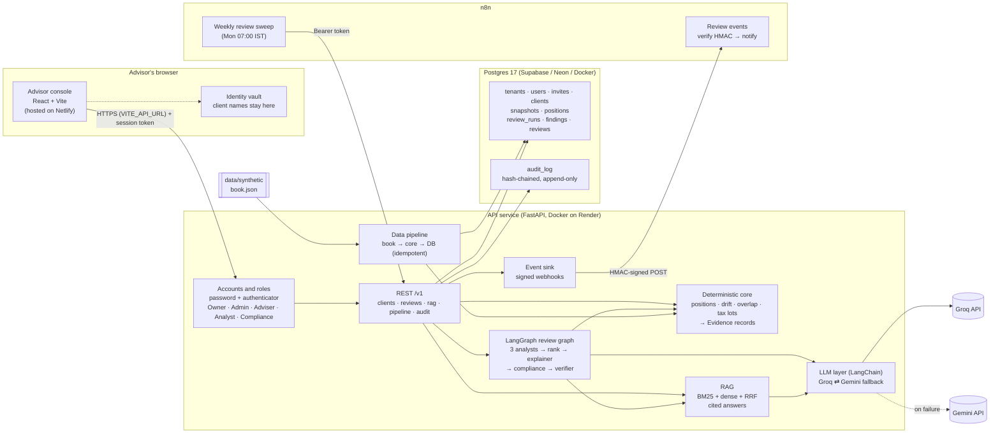
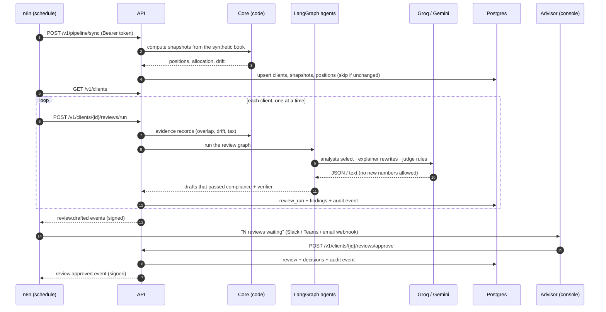
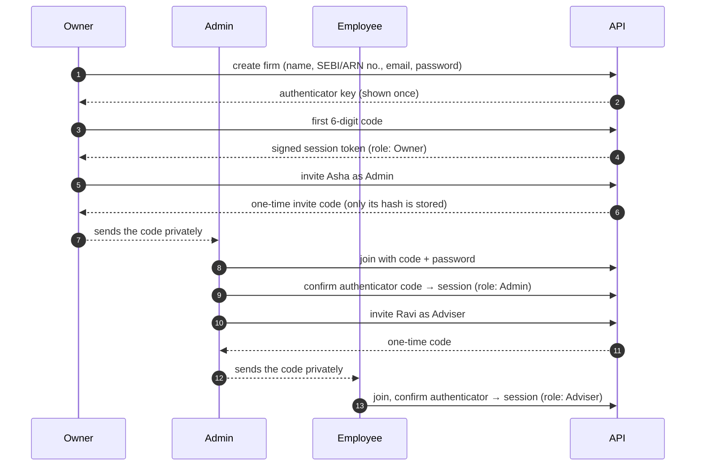
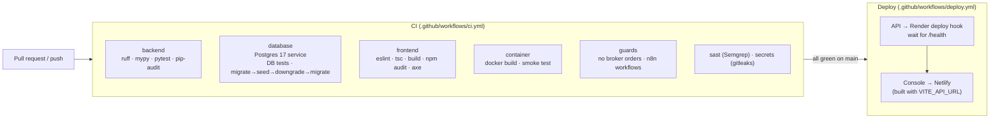

# How AI CFO works

This document explains the system as built: what runs where, how data moves, where the LLMs, LangChain, LangGraph and n8n fit, and how code gets from a branch to production. Everything below runs on **synthetic data** (`data/synthetic/`). No real person's data is used anywhere.

> One rule shapes the whole design: **code computes every number; AI only selects and explains; a human approves.**

---

## 1. System diagram



| Component | Where it runs | What it owns |
|---|---|---|
| **Advisor console** | Netlify (static files) | Screens, the in-browser demo engine, client names (never sent to the server) |
| **API** | Docker container (Render for the demo; India-region VM for real data) | Validation, routing, orchestration |
| **Deterministic core** `aicfo.core` | Inside the API | **Every number**: positions, allocation, drift, look-through exposure, overlap, tax lots |
| **Review graph** `aicfo.agents.review` | Inside the API | The multi-agent review, built with **LangGraph** |
| **LLM layer** `aicfo.llm` | Inside the API | Talking to Groq and Gemini, built with **LangChain** |
| **Data pipeline** `aicfo.db.pipeline` | Inside the API, CLI, or triggered by n8n | Loading data into Postgres |
| **Postgres** | Supabase / Neon (hosted) or Docker (local) | Persistent state and the audit chain |
| **n8n** | Docker (local) or n8n Cloud / self-hosted | Schedules and notifications |

---

## 2. The workflow, end to end



### Step by step
1. **Ingest (data pipeline).** `sync_book` reads `data/synthetic/book.json`, runs the core maths for each client and writes `clients`, `snapshots` and `positions`. A snapshot is keyed by a SHA-256 hash of its inputs, so running the sync again writes nothing until holdings, prices or the engine version change.
2. **Review (agents).** For each client the LangGraph graph runs:
   - `load_snapshot` and `compute_evidence` (code) build **Evidence** records: each holds the formula, the inputs, the steps and the result.
   - Three **analyst agents** run in parallel (overlap, allocation, tax). They choose which evidence matters and how severe it is. The LLM returns JSON that is checked against known evidence IDs.
   - `rank` (code) orders findings by severity and rupee impact.
   - The **explainer** retrieves the governing rule through RAG and cites it `[1]`. The LLM may rewrite the text in plain language.
   - **Compliance** applies rules, then the ML advice classifier, then an LLM judge for borderline scores.
   - The **verifier** (code) rejects any text containing a number that isn't in the evidence or the cited passage. A rejected LLM rewrite falls back to the template built from evidence.
3. **Persist.** The run, its trace, every finding (kept or dropped, with compliance and verifier results) and an audit event are stored.
4. **Notify (n8n).** The API posts a signed `review.drafted` event. The weekly sweep sends one summary ("4 of 12 reviews waiting").
5. **Approve (human).** The advisor accepts, dismisses or snoozes each finding, then approves. The console sends the decisions to `/reviews/approve`, the API stores them, extends the audit chain and emits `review.approved`.
6. **Verify.** `GET /v1/audit/verify` recomputes the hash chain. Any edited, deleted or reordered entry breaks it.

---

## Firm accounts and roles

**Idea:** a firm's access is controlled by the firm, not by us. The Owner creates the firm account; from then on only Owners and Admins can let anyone else in, and they choose each person's role. Nobody can sign up into an existing firm on their own.



| Role | Can do | Cannot do |
|---|---|---|
| **Owner** | Everything: team, firm settings and AI kill switch, audit, approve reviews, appoint Owners and Admins | Change their own role; leave the firm without an Owner |
| **Admin** | Invite people, change staff roles, suspend and restore, read the audit trail | See client data, approve advice, touch Owners or other Admins, grant Owner or Admin |
| **Adviser** | See assigned clients, accept findings and approve reviews, request client consent, upload data | Manage the team |
| **Analyst** | See all clients (read), upload data and resolve exceptions | Approve reviews |
| **Compliance** | See all clients (read), read the audit trail | Approve, manage the team |

**Rules, all in one place** (`backend/src/aicfo/auth/roles.py`, mirrored for the UI in `frontend/src/lib/roles.ts`):
1. You cannot change your own role or suspend yourself.
2. Only an Owner can change an Owner or an Admin, and only an Owner can grant those roles.
3. The firm always keeps at least one active Owner.
4. A role change or suspension takes effect on the very next request, because the API re-reads the user from the database instead of trusting the token.

**How it is protected**
- Passwords are hashed with scrypt (never stored). Authenticator secrets are encrypted with the firm's own data key (envelope encryption), so a database copy alone cannot generate anyone's codes.
- Invite codes are random and stored only as a hash. They expire after 72 hours and work once.
- Sign-in failures give the same message for an unknown email and a wrong password.
- Every account action is written to the hash-chained audit log by user id, never by email or name.
- One firm can never read another's rows: every lookup is scoped by firm, and other firms' records answer "not found".

## 3. Where each technology is used, and why

### LangGraph: orchestration of the agents
The review is a **state graph**, not a free-running agent. Fan-out to three analysts, fan-in to ranking, then a fixed sequence of guards. Every node records a trace event (duration, decision, detail), stored in `review_runs.trace` and replayed in the console's Agents page.

### LangChain: the LLM provider layer only
LangChain is used in one module, `aicfo/llm/providers.py`, for the two things it does better than hand-written code:
- **One chat interface over two vendors**: `ChatGroq` and `ChatGoogleGenerativeAI`.
- **Fallback across vendors**: `primary.with_fallbacks([secondary])`. When Groq's free tier returns 429 or times out, the same prompt goes to Gemini, and the reverse when Gemini is primary.

It is **deliberately not used** for chains, agents, memory or output parsers. The graph is LangGraph; the JSON checks and the number verifier are our own tested code; and agents only see the small `LLMProvider` protocol, so tests use `FakeLLM` and never touch the network.

```
agents / RAG ──▶ LLMProvider protocol ──▶ LangChainLLM ──▶ ChatGroq ──(fails)──▶ ChatGoogleGenerativeAI
                                      └─▶ OpenAICompatibleLLM (Ollama, local)
                                      └─▶ None → deterministic firm policy (CI, offline)
```

### n8n: scheduling and notifications
Two workflows in `infra/n8n/workflows/`:

| Workflow | Trigger | Steps |
|---|---|---|
| **Weekly review sweep** | Cron `0 7 * * 1` (Mon 07:00 IST) or "Run now" | sync pipeline → list clients → run each review (one at a time, 3 s apart, to respect free LLM rate limits) → summarise counts → notify if drafts are waiting |
| **Review events** | Webhook `POST /webhook/aicfo-events` | verify the `X-AICFO-Signature` HMAC → fetch pending reviews → compose message → notify |

Why n8n, not code: schedules, retries and notification channels (Slack, Teams, email, WhatsApp Business) change per firm and are edited by operations staff, not developers. The business logic stays in the API, and n8n only calls it.

**Safety:** n8n sends a bearer token (`AICFO_AUTOMATION_TOKEN`); the API signs every event with HMAC-SHA256; payloads contain IDs and counts only, never names, amounts or finding text. `scripts/check_n8n_workflows.py` fails CI if a workflow hard-codes a host, embeds credentials, skips the token, or calls an API route that doesn't exist.

### Postgres: the database integration pipeline
- **Models:** `aicfo/db/models.py`, a subset of plan §3.4. Every tenant table has `tenant_id`, ready for row-level security.
- **Migrations:** Alembic, in `aicfo/db/migrations/`. They run automatically when the container starts (`docker-entrypoint.sh`) and through `make db-migrate`.
- **Pipeline:** `aicfo/db/pipeline.py`, idempotent ingestion from the synthetic book.
- **Review store:** `aicfo/db/reviews.py`, covering runs, findings, decisions, approvals and the pending list.
- **Audit:** `aicfo/db/audit.py`, a hash-chained log with `verify()`.
- **Privacy:** no names, PAN, emails or phone numbers are stored. A test dumps every table and checks that no client name appears.
- **Tested twice:** on in-memory SQLite in every test run, and on real Postgres 17 + pgvector in CI's `database` job, which also checks that migrations exactly match the models.

---

## 4. CI/CD pipeline



- **CI** runs on every pull request and every push to `main`. It never calls a real LLM or broker API: tests use `FakeLLM`, LangChain's fake chat models, and `respx` for HTTP.
- **CD** runs only after CI succeeds on `main` (`workflow_run`), or by hand. The API deploys first; the console deploys after the API reports healthy, so the frontend never points at an API that is down.

---

## 5. Deployment

| Piece | Service | Config | What you set |
|---|---|---|---|
| Console | **Netlify** | `netlify.toml` | GitHub secrets `NETLIFY_AUTH_TOKEN`, `NETLIFY_SITE_ID`; repo variable `VITE_API_URL` |
| API | **Render** (Docker, Singapore, synthetic demo only) | `render.yaml`, `backend/Dockerfile` | `AICFO_DATABASE_URL`, `AICFO_CORS_ORIGINS`, LLM keys; GitHub secret `RENDER_DEPLOY_HOOK_URL` |
| Database | **Supabase** (Mumbai) or **Neon** | migrations run on API start | the connection string, as `AICFO_DATABASE_URL` |
| n8n | n8n Cloud, or self-hosted Docker | `infra/n8n/workflows/*.json` | `AICFO_API_URL`, `AICFO_AUTOMATION_TOKEN`, `AICFO_N8N_WEBHOOK_SECRET`, `AICFO_NOTIFY_URL` |

**Why Netlify hosts only the console:** Netlify serves static files and JavaScript/Go functions. The API is Python (FastAPI, LangGraph, numpy), so it runs as a container. With `VITE_API_URL` unset, the Netlify site is a complete offline demo that uses the in-browser engine.

**Real client data** must not go on Render Singapore or on the free LLM tiers (plan §1.4, §2). That needs India-region compute, Supabase Mumbai, and Vertex AI Gemini in `asia-south1` or the firm's own model key.

---

## 6. Guarantees, and how each is enforced

| Guarantee | Enforced by |
|---|---|
| No number comes from an LLM | Verifier rejects unsupported numbers; tests inject a fake LLM that adds numbers |
| Advice-like text is blocked for distributors (MFD) | Rules → ML classifier → LLM judge; tests per profile |
| Broker access is read-only | `scripts/check_no_order_apis.py` in CI |
| No personal data in the database or in events | Schema has no identity columns; table-dump test; payload tests |
| Audit history can't be silently edited | Hash chain + `verify()`; tamper test |
| CI never calls paid or real APIs | `tests/conftest.py` forces `AICFO_LLM_PROVIDER=none`; fakes and `respx` |
| Automation can't be spoofed | Bearer token in; HMAC-signed events out |

---

## 7. Reading the code

Every function has a short explanation above it, and nearly every statement has a one-line comment. A good order to read in:

| Step | File | What you learn |
|---|---|---|
| 1 | `backend/src/aicfo/core/analytics.py` | How every number is computed (positions, drift, overlap, tax lots) |
| 2 | `backend/src/aicfo/agents/tools.py` | How numbers become Evidence records with formulas |
| 3 | `backend/src/aicfo/agents/review.py` | The LangGraph agents: analysts, ranking, explainer, compliance, verifier |
| 4 | `backend/src/aicfo/rag/` (`retriever.py`, `answer.py`) | Hybrid search, cited answers, and the checks that reject invented numbers |
| 5 | `backend/src/aicfo/llm/providers.py` | Groq and Gemini through LangChain, with fallback |
| 6 | `backend/src/aicfo/auth/` | Roles, passwords, tokens, authenticator codes, invites |
| 7 | `backend/src/aicfo/db/` | Tables, migrations, the data pipeline, the audit chain |
| 8 | `backend/src/aicfo/api/` | The HTTP routes that tie it together |
| 9 | `frontend/src/lib/roles.ts`, `frontend/src/components/auth/` | The same role rules in the console, and the sign-up / join / sign-in screens |

## RAG: what was measured

`uv run python -m aicfo.rag eval` scores retrieval on two question sets (does the right document come back first?). The plain set (28 questions, `data/evals/rag_golden.json`) is saturated: every method scores 100%. The hard set (16 paraphrases that avoid the documents' own words, `data/evals/rag_hard.json`) separates them:

| Method | right document first | within top 3 |
|---|---|---|
| Keywords only (BM25) | 69% | 94% |
| Offline hashing "embeddings" (default) | 69% | 88% |
| **Real embeddings (bge-small)** | **100%** | **100%** |
| Hybrid (BM25 + bge-small, fused) | 88% | 100% |

So meaning-based search is what makes paraphrased questions work, and the offline default is only a fallback; use `AICFO_RAG_EMBEDDER=fastembed` for real use. On this small set the embeddings alone slightly beat the hybrid; the hybrid is kept because keywords still win on exact terms such as section numbers. The set is small (16), so treat the gap as indicative, not final.

## 8. Which LLM works better here

The benchmark (`make llm-bench`) measures how much of each model's output survives *this app's* checks, not how fluent it sounds. On the tested keys Groq `openai/gpt-oss-120b` passed every check with no failed calls (median 1.6 s); Gemini `gemini-3-flash-preview` failed 17 of 38 calls on free-tier quota and timeouts and passed far fewer checks. Full numbers and caveats: [docs/llm-benchmark.json](docs/llm-benchmark.json) and the README.

Two real bugs were found by this benchmark and fixed: Groq writes citation markers as `【1】`, which the verifier did not recognise (so valid answers were rejected), and the rewrite prompt now tells the model to keep each number attached to what it describes.
