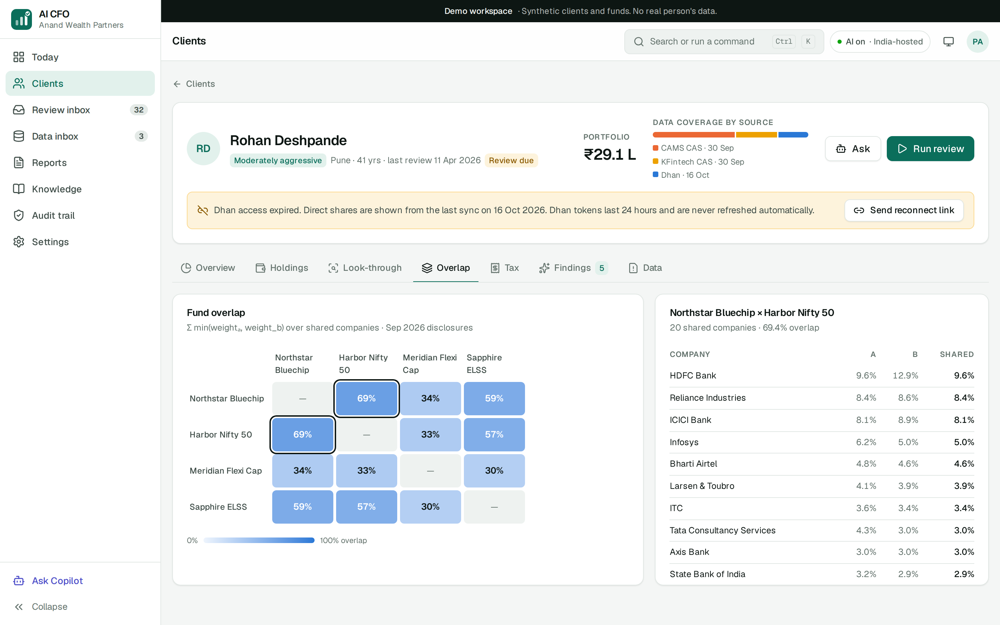
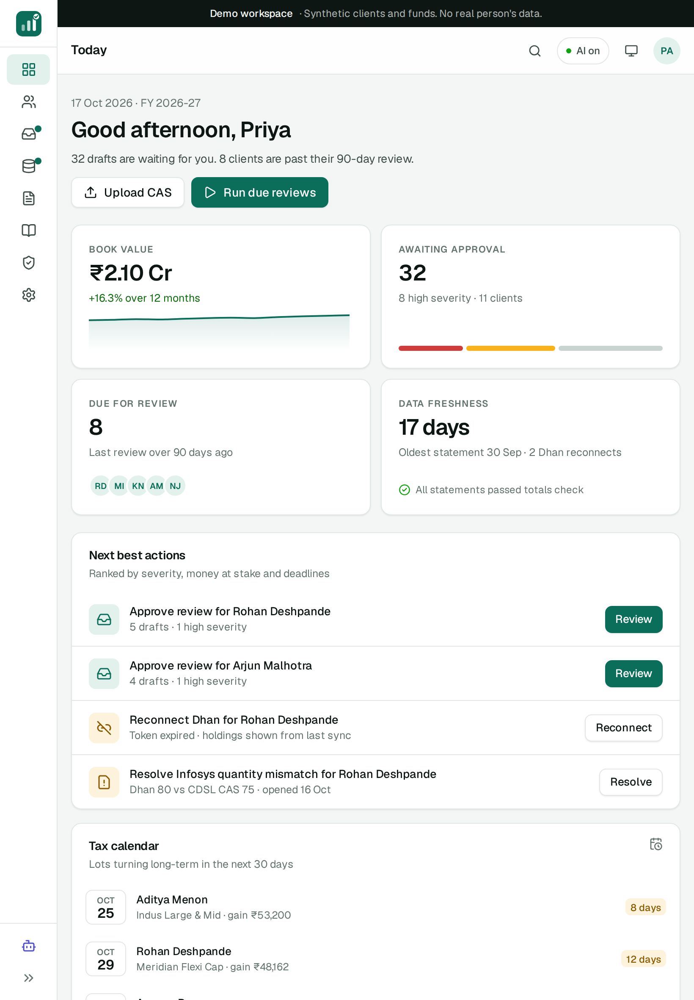
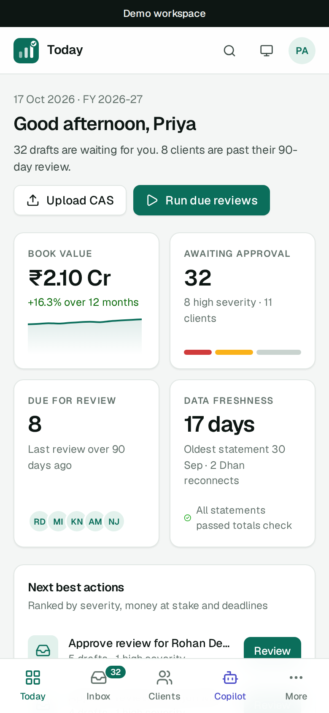

# AI CFO

**Portfolio intelligence for Indian wealth professionals.** AI CFO ingests every client's holdings from statements and data feeds, computes look-through overlap, allocation drift and capital-gains position deterministically, and drafts cited, compliance-checked review notes that the advisor approves before anything reaches a client.

> Every number computed. Every claim cited. Every action audited. The advisor always in control.

**Status:** Phase 0 (foundation). Not production-ready. See the [plan](docs/plan/03_AI_CFO_V3_B2B.md) and the [status checklist](docs/plan/03_AI_CFO_V3_B2B.md#5-status-checklist-living-document).

---

## Why
Indian investors hold money across brokers, mutual fund houses and apps. Reviewing one client properly (true exposure, fund overlap, drift from the agreed risk level, tax lots about to turn long-term) takes an advisor hours. AI CFO turns that into minutes, without letting an AI invent numbers.

## How it works
```
Data in                     Exact maths (tested code)      AI (explains, never computes)     Human
────────                    ─────────────────────────      ─────────────────────────────     ─────
CAS (NSDL/CDSL/CAMS/KFin) ┐  look-through exposure          3 analyst agents select findings  advisor
Dhan live (read-only)     ├▶ fund overlap            ────▶  explainer (RAG, cited)    ────▶  reviews,
Distributor feeds         │  allocation drift              compliance (rules→ML→LLM judge)   approves
Tradebook files           ┘  FIFO lots + FY tax rules       verifier: no unsupported numbers  → client
```

## Screenshots
Synthetic demo data: every client, firm and fund name is fictional.

| Today (bento dashboard) | Client 360 · fund overlap |
|---|---|
|  |  |
| **Every number explains itself** | **Review inbox (dark)** |
|  |  |

<p align="center"> &nbsp; </p>

## Design commitments
- **Zero-access identity.** Client names and PAN are encrypted in the advisor's browser. The server stores pseudonymous portfolios only. See [ADR-0003](docs/adr/0003-zero-access-privacy.md).
- **Read-only broker access.** The code contains no order-placement calls, and CI fails if any are added.
- **India-resident data.** Real client data runs only on India-region infrastructure.
- **Deterministic core.** Every financial number comes from unit-tested code; LLMs only select and explain.
- **Measured AI.** Faithfulness, citation accuracy and compliance block rate are evaluated continuously.

## Repository layout
| Path | Contents |
|---|---|
| `backend/` | FastAPI service, core maths, agents, RAG (Python 3.12, uv) |
| `frontend/` | Advisor console: React 19 + Vite + TypeScript, Tailwind v4, TanStack Router, Radix, Recharts (demo data for now) |
| `infra/` | Docker Compose for local development |
| `data/` | Dataset scripts and docs (raw data is git-ignored) |
| `docs/plan/` | Project plans (v2 review, v3 B2B plan) |
| `docs/adr/` | Architecture Decision Records |
| `scripts/` | Repository checks (e.g. broker order-API guard) |

## Quick start (development)
Requires [uv](https://docs.astral.sh/uv/) and Docker.
```bash
make dev-up        # Postgres + pgvector, OpenBao (dev mode)
make install       # backend dependencies
make check         # lint, types, tests, guards
make run           # API on http://localhost:8000 (GET /health)
make web           # advisor console on http://localhost:5173 (synthetic demo data)
```

## Security
See [SECURITY.md](SECURITY.md). Never commit real client data, broker tokens or keys.

## Licence
Proprietary. All rights reserved. See [LICENSE](LICENSE).

*AI CFO is decision-support software for registered professionals. It does not provide investment advice to the public.*
